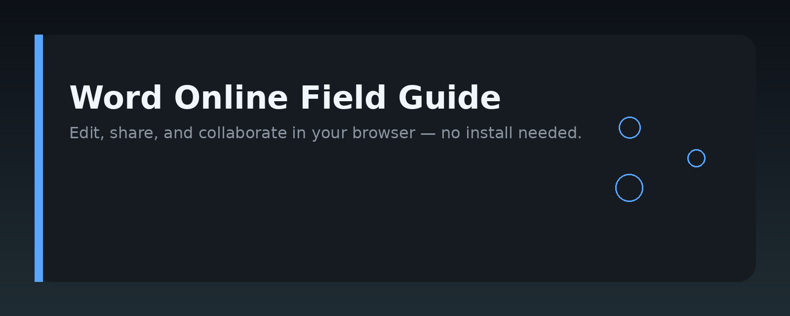
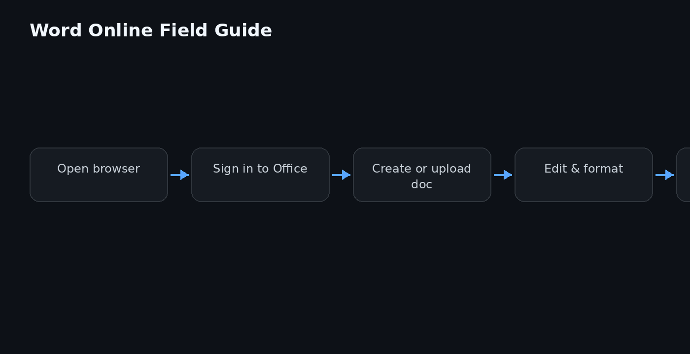

# Microsoft Word Online: A Practical Handbook




## Overview

Microsoft Word Online is the browser-based edition of Microsoft Word that runs entirely inside a web browser with no local installation. This repository is a practical handbook for developers, technical writers, and IT administrators who work with Word Online — whether you are integrating it into a web app, automating document workflows, or supporting users who rely on it daily.

The handbook covers the core capabilities of Word Online, how it differs from the desktop client, how it fits into the Microsoft 365 ecosystem, and how to build real workflows around it. Every section is written to be immediately useful: you get concrete steps, working code samples, and clear explanations of the underlying concepts.

## Why it exists

Word Online solves a specific set of problems that the desktop version does not address well:

- **No installation required.** Anyone with a browser and a Microsoft account can open, edit, and share documents on any device.
- **Real-time collaboration.** Multiple people can edit the same document simultaneously, with presence indicators and version history.
- **Cross-platform access.** Word Online works on Windows, macOS, Linux, ChromeOS, and mobile browsers — no native app needed.
- **Embedding and automation.** Developers can embed Word Online documents in their own applications, or automate document creation and editing through the Microsoft Graph API.
- **Centralized management.** IT teams can control document policies, sharing permissions, and compliance settings from a single admin console.

This handbook exists because most documentation about Word Online is either vendor-published marketing material or scattered forum answers. This repo consolidates the practical knowledge into one place: how Word Online works, how to use it effectively, and how to build on top of it.

## Core concepts

Before working with Word Online, you need to understand a few foundational ideas.

### Document storage

Word Online does not store files on your local disk. Documents live in OneDrive, SharePoint, or Microsoft 365 Groups. When you open a `.docx` file from these locations, Word Online loads it into the browser, tracks changes in real time, and saves back to the same location.

### File format

Word Online works natively with the Office Open XML format (`.docx`). It can open and convert legacy `.doc` files, but editing is always done in `.docx`. The format is a ZIP archive containing XML files that describe the document structure, styles, and content.

### Co-authoring

Co-authoring is built into Word Online. When multiple users open the same document, each sees the others' cursors and selections. Changes are merged automatically, and version history lets you restore any previous state.

### Add-ins

Word Online supports Office Add-ins — small web applications that extend the editor. Add-ins are built with HTML, CSS, and JavaScript, and run inside an iframe within the Word Online interface. They can read and modify document content, insert content, and respond to user actions.

### Microsoft Graph

For programmatic access, Microsoft Graph is the API layer for Word Online documents. You can create, read, update, and delete files, manage permissions, and track changes — all without opening the editor.

## Architecture

The following diagram shows the high-level architecture of Word Online and its surrounding ecosystem.


The architecture breaks down into these layers:

1. **Browser client.** The Word Online web application runs in the browser. It renders the document, handles user input, and communicates with the server over HTTPS.
2. **Office Online server.** The server-side component manages document state, co-authoring sessions, and persistence. It also hosts the add-in runtime.
3. **Storage layer.** Documents are stored in OneDrive or SharePoint. The storage layer handles file permissions, versioning, and compliance policies.
4. **Microsoft Graph API.** This REST API provides programmatic access to documents, users, and permissions. Applications use it to automate workflows.
5. **Add-in runtime.** Office Add-ins run in a sandboxed iframe, isolated from the main document. They interact with the document through a JavaScript API.

When a user opens a document, the browser loads the Word Online client, which connects to the Office Online server. The server retrieves the document from storage, streams it to the client, and maintains a WebSocket connection for real-time updates during co-authoring.

## Practical workflow

Here is a typical workflow for building a document automation solution around Word Online.

### Step 1: Set up an Azure app registration

To use Microsoft Graph, you need an Azure app registration with the right permissions.

1. Go to the Azure portal and create a new app registration.
2. Note the application (client) ID and directory (tenant) ID.
3. Add a client secret or configure certificate-based authentication.
4. Grant the `Files.ReadWrite` and `Sites.ReadWrite.All` delegated permissions.

### Step 2: Authenticate and get an access token

Use the OAuth 2.0 authorization code flow to get an access token. Here is a minimal example using `axios` in Node.js:

```javascript
const axios = require('axios');

async function getAccessToken(tenantId, clientId, clientSecret, code) {
  const params = new URLSearchParams({
    grant_type: 'authorization_code',
    client_id: clientId,
    client_secret: clientSecret,
    code: code,
    redirect_uri: 'http://localhost:3000/callback',
    scope: 'https://graph.microsoft.com/Files.ReadWrite offline_access'
  });

  const response = await axios.post(
    `https://login.microsoftonline.com/${tenantId}/oauth2/v2.0/token`,
    params
  );

  return response.data.access_token;
}
```

### Step 3: Create a document in OneDrive

With a valid token, you can create a new `.docx` file programmatically.

```javascript
const fs = require('fs');
const axios = require('axios');

async function createDocument(accessToken, fileName) {
  const fileContent = fs.readFileSync('template.docx');
  const response = await axios.put(
    `https://graph.microsoft.com/v1.0/me/drive/root:/${fileName}:/content`,
    fileContent,
    {
      headers: {
        'Authorization': `Bearer ${accessToken}`,
        'Content-Type': 'application/octet-stream'
      }
    }
  );

  return response.data;
}
```

### Step 4: Open the document in Word Online

Once the file exists, generate a sharing link and open it in the browser.

```javascript
async function getSharingLink(accessToken, itemId) {
  const response = await axios.post(
    `https://graph.microsoft.com/v1.0/me/drive/items/${itemId}/createLink`,
    {
      type: 'edit',
      scope: 'organization'
    },
    {
      headers: {
        'Authorization': `Bearer ${accessToken}`,
        'Content-Type': 'application/json'
      }
    }
  );

  return response.data.link.webUrl;
}
```

The returned URL opens the document directly in Word Online.

### Step 5: Build a Word Online add-in

For deeper integration, build an Office Add-in that runs inside Word Online. The add-in manifest is XML, and the code is plain web technology.

**Manifest.xml (excerpt):**

```xml
<?xml version="1.0" encoding="UTF-8"?>
<OfficeApp xmlns="http://schemas.microsoft.com/office/appforoffice/1.1"
           xmlns:xsi="http://www.w3.org/2001/XMLSchema-instance"
           xsi:type="TaskPaneApp">
  <Id>12345678-1234-1234-1234-123456789012</Id>
  <Version>1.0.0.0</Version>
  <ProviderName>Your Company</ProviderName>
  <DefaultLocale>en-US</DefaultLocale>
  <DisplayName DefaultValue="Document Helper"/>
  <Description DefaultValue="A helper add-in for Word Online."/>
  <Hosts>
    <Host Name="Document"/>
  </Hosts>
  <DefaultSettings>
    <SourceLocation DefaultValue="https://localhost:3000/taskpane.html"/>
  </DefaultSettings>
  <Permissions>ReadWriteDocument</Permissions>
</OfficeApp>
```

**taskpane.html:**

```html
<!DOCTYPE html>
<html>
<head>
  <meta charset="UTF-8" />
  <script src="https://appsforoffice.microsoft.com/lib/1/hosted/office.js"></script>
</head>
<body>
  <h1>Document Helper</h1>
  <button id="insert-text">Insert Text</button>

  <script>
    Office.onReady((info) => {
      if (info.host === Office.HostType.Word) {
        document.getElementById('insert-text').onclick = () => {
          Word.run((context) => {
            const body = context.document.body;
            body.insertText('Hello from Word Online add-in!', Word.InsertLocation.end);
            return context.sync();
          });
        };
      }
    });
  </script>
</body>
</html>
```

## Examples

### Example 1: Convert a document to PDF via Graph

```python
import requests

def convert_to_pdf(access_token, item_id):
    url = f"https://graph.microsoft.com/v1.0/me/drive/items/{item_id}/content?format=pdf"
    headers = {"Authorization": f"Bearer {access_token}"}
    response = requests.get(url, headers=headers, stream=True)
    with open("output.pdf", "wb") as f:
        for chunk in response.iter_content(chunk_size=8192):
            f.write(chunk)
    return "output.pdf"
```

### Example 2: List all recent Word documents in OneDrive

```bash
curl -X GET \
  "https://graph.microsoft.com/v1.0/me/drive/root/search(q='.docx')" \
  -H "Authorization: Bearer YOUR_ACCESS_TOKEN"
```

### Example 3: Add a comment to a Word Online document

```javascript
const axios = require('axios');

async function addComment(accessToken, itemId, commentText) {
  const response = await axios.post(
    `https://graph.microsoft.com/v1.0/drive/items/${itemId}/workbook/comments`,
    {
      content: commentText
    },
    {
      headers: {
        'Authorization': `Bearer ${accessToken}`,
        'Content-Type': 'application/json'
      }
    }
  );
  return response.data;
}
```

### Example 4: Embed a Word Online document in your own web page

```html
<iframe
  src="https://office.com/launch/word?auth=1&wopi=YOUR_WOPI_URL"
  width="100%"
  height="600"
  frameborder="0"
  allowfullscreen>
</iframe>
```

## FAQ

**Is Word Online free?**
Yes, with a free Microsoft account you get basic Word Online access. Full features, larger storage, and admin controls require a Microsoft 365 subscription.

**Can Word Online open .doc files?**
Yes, it can open and convert legacy `.doc` files, but saving always produces `.docx` format.

**Does Word Online work offline?**
No. Word Online requires an active internet connection. For offline editing, use the desktop version of Word.

**How do I enable co-authoring?**
Co-authoring is enabled by default when you share a document with edit permissions. No extra configuration is needed.

**Can I automate Word Online with a script?**
Yes, through the Microsoft Graph API. You can create, edit, and share documents programmatically, as shown in the examples above.

**What are Office Add-ins?**
Office Add-ins are small web applications that extend Word Online. They are built with HTML, CSS, and JavaScript and run inside the editor.

**Is there a way to convert Word Online documents to other formats?**
Yes, use the Graph API `?format=pdf` parameter, or export through the Word Online interface.

**What browsers are supported?**
Word Online supports current versions of Chrome, Edge, Firefox, and Safari.

## License

MIT License

Copyright (c) 2024 msword-online-handbook-docs contributors

Permission is hereby granted, free of charge, to any person obtaining a copy
of this software and associated documentation files (the "Software"), to deal
in the Software without restriction, including without limitation the rights
to use, copy, modify, merge, publish, distribute, sublicense, and/or sell
copies of the Software, and to permit persons to whom the Software is
furnished to do so, subject to the following conditions:

The above copyright notice and this permission notice shall be included in all
copies or substantial portions of the Software.

THE SOFTWARE IS PROVIDED "AS IS", WITHOUT WARRANTY OF ANY KIND, EXPRESS OR
IMPLIED, INCLUDING BUT NOT LIMITED TO THE WARRANTIES OF MERCHANTABILITY,
FITNESS FOR A PARTICULAR PURPOSE AND NONINFRINGEMENT. IN NO EVENT SHALL THE
AUTHORS OR COPYRIGHT HOLDERS BE LIABLE FOR ANY CLAIM, DAMAGES OR OTHER
LIABILITY, WHETHER IN AN ACTION OF CONTRACT, TORT OR OTHERWISE, ARISING FROM,
OUT OF OR IN CONNECTION WITH THE SOFTWARE OR THE USE OR OTHER DEALINGS IN THE
SOFTWARE.

Topic: `msword-online-guide`
